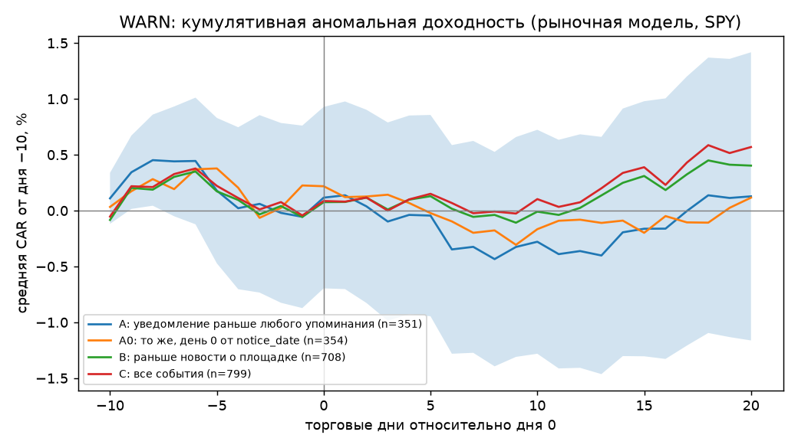

# Stage 4 — event study (2026-10-06)

Day 0 — the first trading day strictly after the notice appeared on the state's site (public_date). Market model on [−250, −30], SPY. Filters: price ≥ $5 on day −1, ≥ 200 days in the estimation window, no other 8-K in [−2, +2]. Event = company × day 0.

## Sample A (main): notice before any mention of layoffs

Events (company × day 0): 496; computed: 351; dropped: {'no prices': 4, 'price < $5': 25, 'short history': 6, '8-K in [−2,+2]': 110}.

| Window | N | Mean CAR | Median | Share < 0 | t | t BMP | t by date |
|---|---|---|---|---|---|---|---|
| [-5,-1] | 351 | -0.50% | -0.21% | 53% | -1.66 | -1.61 | -2.15 |
| [0,+5] | 351 | +0.01% | -0.19% | 52% | +0.04 | -0.54 | +1.00 |
| [0,+20] | 351 | +0.18% | -1.01% | 54% | +0.33 | -0.10 | +1.03 |
| [0,pub) | 114 | -0.08% | +0.15% | 47% | -0.13 | +0.16 | +0.21 |

Check — return minus the sector ETF:

| Window | N | Mean CAR | Median | Share < 0 | t | t BMP | t by date |
|---|---|---|---|---|---|---|---|
| [-5,-1] | 351 | -0.49% | -0.18% | 53% | -1.63 | +nan | -2.18 |
| [0,+5] | 351 | +0.07% | -0.07% | 52% | +0.27 | +nan | +1.20 |
| [0,+20] | 351 | +0.19% | -0.80% | 54% | +0.35 | +nan | +1.13 |

## Sample A0: same events, day 0 — after notice_date (the date received by the state, as in the spec)

Events (company × day 0): 495; computed: 354; dropped: {'no prices': 4, 'price < $5': 25, 'short history': 6, '8-K in [−2,+2]': 106}.

| Window | N | Mean CAR | Median | Share < 0 | t | t BMP | t by date |
|---|---|---|---|---|---|---|---|
| [-5,-1] | 354 | -0.14% | -0.07% | 51% | -0.44 | -0.95 | -0.32 |
| [0,+5] | 354 | -0.25% | -0.20% | 53% | -0.92 | -1.27 | -0.77 |
| [0,+20] | 354 | -0.11% | -0.97% | 55% | -0.20 | -0.77 | -0.12 |
| [0,pub) | 112 | -0.42% | -0.26% | 54% | -0.66 | -0.85 | -0.69 |

Check — return minus the sector ETF:

| Window | N | Mean CAR | Median | Share < 0 | t | t BMP | t by date |
|---|---|---|---|---|---|---|---|
| [-5,-1] | 354 | +0.06% | -0.02% | 51% | +0.20 | +nan | +0.38 |
| [0,+5] | 354 | -0.26% | -0.21% | 52% | -0.94 | +nan | -0.86 |
| [0,+20] | 354 | -0.11% | -0.74% | 56% | -0.22 | +nan | -0.01 |

## Sample B: notice before site news

Events (company × day 0): 1035; computed: 708; dropped: {'no prices': 6, 'price < $5': 58, 'short history': 13, '8-K in [−2,+2]': 250}.

| Window | N | Mean CAR | Median | Share < 0 | t | t BMP | t by date |
|---|---|---|---|---|---|---|---|
| [-5,-1] | 708 | -0.41% | -0.10% | 51% | -1.79 | -1.66 | -2.00 |
| [0,+5] | 708 | +0.19% | +0.01% | 50% | +0.87 | +0.33 | +1.36 |
| [0,+20] | 708 | +0.46% | -0.38% | 51% | +1.12 | +0.53 | +1.49 |
| [0,pub) | 114 | -0.08% | +0.15% | 47% | -0.13 | +0.16 | +0.21 |

Check — return minus the sector ETF:

| Window | N | Mean CAR | Median | Share < 0 | t | t BMP | t by date |
|---|---|---|---|---|---|---|---|
| [-5,-1] | 708 | -0.50% | -0.12% | 52% | -2.16 | +nan | -2.31 |
| [0,+5] | 708 | +0.14% | -0.12% | 51% | +0.67 | +nan | +0.88 |
| [0,+20] | 708 | +0.24% | -0.23% | 51% | +0.59 | +nan | +0.66 |

## Sample C: all events

Events (company × day 0): 1172; computed: 799; dropped: {'no prices': 6, 'price < $5': 58, 'short history': 15, '8-K in [−2,+2]': 294}.

| Window | N | Mean CAR | Median | Share < 0 | t | t BMP | t by date |
|---|---|---|---|---|---|---|---|
| [-5,-1] | 799 | -0.42% | -0.14% | 52% | -1.94 | -1.74 | -1.58 |
| [0,+5] | 799 | +0.19% | -0.02% | 50% | +0.93 | +0.34 | +0.79 |
| [0,+20] | 799 | +0.61% | -0.20% | 51% | +1.52 | +1.13 | +1.48 |
| [0,pub) | 114 | -0.08% | +0.15% | 47% | -0.13 | +0.16 | +0.21 |

Check — return minus the sector ETF:

| Window | N | Mean CAR | Median | Share < 0 | t | t BMP | t by date |
|---|---|---|---|---|---|---|---|
| [-5,-1] | 799 | -0.48% | -0.16% | 53% | -2.24 | +nan | -1.95 |
| [0,+5] | 799 | +0.15% | -0.13% | 52% | +0.72 | +nan | +0.25 |
| [0,+20] | 799 | +0.36% | -0.12% | 50% | +0.93 | +nan | +0.52 |

## Slices (sample A)

### CAR [0,+5]

| Slice | Group | N | Mean CAR | t |
|---|---|---|---|---|
| layoff share | T1 (small share) (median 0.04%) | 114 | +0.11% | +0.34 |
| layoff share | T2 (median 0.22%) | 113 | +0.51% | +1.26 |
| layoff share | T3 (large share) (median 1.26%) | 114 | -0.50% | -0.84 |
| type | layoff/unspecified | 213 | +0.07% | +0.21 |
| type | closure | 138 | -0.08% | -0.20 |
| market cap | small | 100 | +0.03% | +0.04 |
| market cap | mid | 100 | -0.25% | -0.50 |
| market cap | large | 101 | +0.14% | +0.48 |
| state | CA | 249 | -0.27% | -0.86 |
| state | NY | 41 | +0.83% | +1.01 |
| state | TX | 44 | +0.93% | +1.50 |
| state | WA | 17 | -0.30% | -0.23 |

Regression of CAR[0,+5] on log(layoff share): slope -0.0011, t = -0.75 (H2 expects a negative slope).

### CAR [0,+20]

| Slice | Group | N | Mean CAR | t |
|---|---|---|---|---|
| layoff share | T1 (small share) (median 0.04%) | 114 | +0.48% | +0.65 |
| layoff share | T2 (median 0.22%) | 113 | +0.17% | +0.17 |
| layoff share | T3 (large share) (median 1.26%) | 114 | +0.11% | +0.09 |
| type | layoff/unspecified | 213 | +0.45% | +0.59 |
| type | closure | 138 | -0.23% | -0.29 |
| market cap | small | 100 | -0.03% | -0.03 |
| market cap | mid | 100 | -0.53% | -0.53 |
| market cap | large | 101 | +0.48% | +0.63 |
| state | CA | 249 | -0.10% | -0.14 |
| state | NY | 41 | +0.17% | +0.11 |
| state | TX | 44 | +2.69% | +2.13 |
| state | WA | 17 | -2.16% | -0.88 |

Regression of CAR[0,+20] on log(layoff share): slope +0.0002, t = +0.07 (H2 expects a negative slope).

## Verdict on the stage 4 criterion

Condition: CAR [0,+5] or [0,+20] is significantly negative (|t| ≥ 2.0) and grows in magnitude with the layoff share.

- [0,+5]: mean +0.01%, t = +0.04 (BMP -0.54, by date +1.00) — not significant; slope by share t = -0.75 — does not grow.
- [0,+20]: mean +0.18%, t = +0.33 (BMP -0.10, by date +1.03) — not significant; slope by share t = +0.07 — does not grow.

**Result: condition NOT met — per the spec the project closes, the live collector stays as a dataset.**

## Caveats

- The company's headcount is current (yfinance fullTimeEmployees), not as of the event date; it is not tagged in XBRL in the 10-K.
- Only currently traded companies (the SEC reference by current tickers) — delisted ones dropped out.
- Day 0 in CA is the first Tue/Thu after processing (conservative); the real appearance may have been earlier, in which case part of the reaction falls into [−5,−1].
- The "no 8-K in [−2,+2]" filter cuts large companies the most (they file 8-Ks often).
